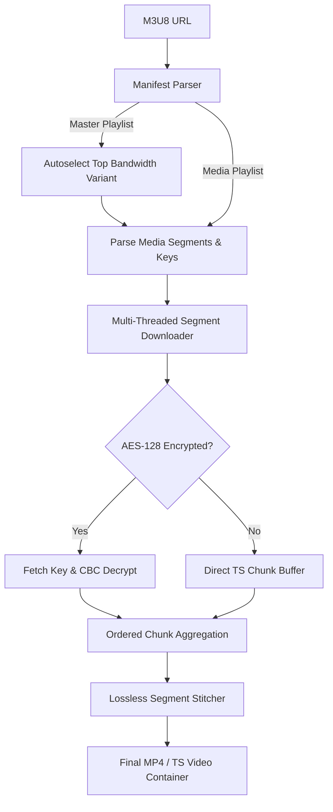

# ⚡ FastHLS-Downloader

<div align="center">

```
  ███████╗ █████╗ ███████╗████████╗██╗  ██╗██╗     ███████╗
  ██╔════╝██╔══██╗██╔════╝╚══██╔══╝██║  ██║██║     ██╔════╝
  █████╗  ███████║███████╗   ██║   ███████║██║     ███████╗
  ██╔══╝  ██╔══██║╚════██║   ██║   ██╔══██║██║     ╚════██║
  ██║     ██║  ██║███████║   ██║   ██║  ██║███████╗███████║
  ╚═╝     ╚═╝  ╚═╝╚══════╝   ╚═╝   ╚═╝  ╚═╝╚══════╝╚══════╝
```

**High-Performance Multi-Threaded HLS Stream Grabber, AES-128 Decryptor & TS Segment Stitcher**

[](https://www.python.org/downloads/)
[](https://opensource.org/licenses/MIT)
[](https://github.com/psf/black)
[]()

</div>

---

## ⚡ Overview

**FastHLS-Downloader** is a high-speed command-line tool built in Python to capture, decrypt, and assemble HTTP Live Streaming (HLS `.m3u8`) video streams into single playable video files.

Designed for maximum throughput, FastHLS-Downloader splits media playlists into parallel segment queues, fetches chunks concurrently using multi-threaded pools, handles encrypted AES-128 streams on-the-fly, and losslessly stitches MPEG-TS chunks with zero re-encoding artifacts.

---

## ✨ Features

- 🚀 **16x+ Concurrent Segment Pipeline**: Pulls video segments simultaneously across configurable thread pools to saturate your full bandwidth.
- 🔐 **Transparent AES-128 Decryption**: Automatically resolves `#EXT-X-KEY` tags, fetches remote key URIs, and applies inline AES-128-CBC decryption.
- 📺 **Master Playlist Autoselection**: Intelligently parses multi-bitrate master manifests and selects the highest resolution/bandwidth variant.
- 🧩 **Lossless Zero-Reencode Stitcher**: Directly concatenates binary MPEG-TS packets (sync byte `0x47`) without quality loss. Supports fast automatic remuxing to `.mp4` if ffmpeg is available.
- 🔁 **Resilient Retry Queue**: Exponential backoff retry handler for dropped network packets or temporary CDN throttling.
- 📊 **Rich Progress UI**: Terminal progress bar with percentage, downloaded chunks tally, and time remaining powered by `rich`.

---

## 🚀 Installation

```bash
# Clone the repository
git clone https://github.com/loveslaw/FastHLS-Downloader.git
cd FastHLS-Downloader

# Install dependencies
pip install -r requirements.txt
```

---

## 📖 CLI Usage

### 1. Basic Stream Download
Download an HLS stream into an MP4 video file:
```bash
python main.py "https://example.com/stream/playlist.m3u8" -o output.mp4
```

### 2. High-Speed 32-Thread Worker Pipeline
Accelerate download speeds on high-bandwidth connections:
```bash
python main.py "https://example.com/stream/master.m3u8" -o movie.mp4 -c 32
```

### 3. Interactive Prompt Mode
Run without arguments to enter the interactive prompt:
```bash
python main.py
```

---

## 🏗️ Architecture



---

## 🧪 Testing

Run automated unit tests verifying master/media parsing, AES-128 decryption, and lossless segment concatenation:
```bash
python -m pytest tests/ -v
```

---

## 📜 License

Distributed under the [MIT License](LICENSE).
Author: **loveslaw**
